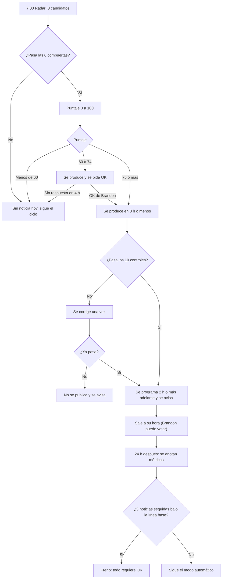

# Protocolo de NOTICIAS — video opcional del día (creado 2026-11-09)

Objetivo: sacar un video de noticia financiera el mismo día del hecho (idealmente a menos de 12 h), sin depender de producto, y decidir solo si vale la pena publicarlo. Si ese día no hay noticia que lo merezca, no hay noticia: el ciclo normal sigue igual.

## 1. Dónde cae en la cadencia
- Glosario diario: igual (2:00, Buffer).
- **NUEVO 7:00 CDMX — Radar de noticias.** Revisa portales, movimientos del mercado y Google Trends; deja 3 candidatos y un veredicto (GO / NO-GO) en `noticias/AAAA-MM-DD.md`. Si es GO, el mismo radar produce y programa el video.
- 11:00 video principal: primero lee `noticias/AAAA-MM-DD.md`.
  - Si hay noticia aprobada ese día → la noticia ES el video principal del día (siguen siendo 2 videos al día).
  - El tema desplazado (educativo o producto) se queda de primero en su lista; no se pierde. El ciclo educativo-educativo-producto sigue por fecha; el tema desplazado sale en el siguiente turno de su tipo.
  - Estados del día en `noticias/AAAA-MM-DD.md`: APROBADA (la noticia es el principal), ESPERA_OK (lista pero sin permiso: el principal sale normal y, con OK, la noticia sale como publicación extra si cabe en el cupo de 3) y NO_GO.
  - Si no hay noticia → ciclo normal.
- Herramienta de publicación: Metricool (video largo), mismo flujo de `publicar-temp`.

## 2. Compuertas (si falla UNA, no hay video)
1. **Fresca:** el hecho tiene menos de 24 h y se puede publicar a menos de 8 h de detectarlo.
2. **Verificada:** el dato central está en 2 fuentes independientes, una primaria o agencia (Reuters, Bloomberg, AP, Banxico, INEGI, BMV, Fed).
3. **Segura:** sin «compra/vende», sin rendimientos, sin rumores ni personas privadas, sin postura partidista (solo el efecto en el mercado), sin tragedias como gancho, sin productos ni logo de Actinver.
4. **Cupo:** máximo 1 noticia al día y 3 a la semana; 3 publicaciones en total ese día; 3 h o más entre publicaciones; hora entre 7:00 y 21:00.
5. **Hilo claro:** se cuenta en 3 frases: qué pasó → a quién golpeó → qué vigilar.
6. **Factible:** guion de 60 s o menos y entrega en 3 h o menos.

## 3. Puntaje de la noticia (0–100)
| Criterio | Puntos | Cómo se califica |
|---|---|---|
| Movimiento de mercado | 0–30 | Índice (S&P 500, Nasdaq, IPC): 1–2 % = 10, 2–3 % = 20, 3 % o más = 30. Dólar/peso: 0.7–1.2 % = 10, 1.2–2 % = 20, 2 % o más = 30. Empresa emblemática: 5–8 % = 10, 8–15 % = 20, 15 % o más = 30. Decisión o dato oficial (Banxico, Fed, inflación INEGI): 20 si es relevante, 30 si sorprende. Se toma el mayor. |
| Interés de búsqueda | 0–25 | Top 10 de Google Trends (México o EE.UU.) = 25; Top 11–25 = 18; en portada de 3 o más portales financieros = 10; en 1 portal = 4; nada = 0. |
| Relevancia para México | 0–20 | Toca peso, tasas, crédito, ahorro, Afore o precios = 20; bolsa de EE.UU. con efecto en IPC o peso = 12; solo extranjera = 4. |
| Frescura | 0–15 | 6 h o menos = 15; hasta 12 h = 10; hasta 24 h = 5. |
| Claridad del ángulo | 0–10 | Dato central + causa + qué vigilar, todo verificado = 10; falta uno = 5; faltan dos = 0. |
| Bono de gancho | +5 | El #1 de Google Trends se conecta de forma real con la noticia. Si no se conecta, no se fuerza. |

## 4. Decisión
- **75 o más → se aprueba sola.** Se produce, pasa el control de calidad y se programa.
- **60 a 74 → se produce y se pide OK a Brandon.** Si no contesta en 4 h, se descarta (no se publica).
- **Menos de 60 → se descarta.** Se anota en `noticias/` para tener historial.

**Modo supervisado (arranque):** las primeras 3 noticias y cualquier semana después de un freno automático requieren OK de Brandon sin importar el puntaje.

## 5. Control de calidad antes de programar (los 10 deben pasar)
1. Duración de 45 a 60 s (máximo 75).
2. Primer fotograma con el tema; gancho de 8 palabras o menos con la fecha del hecho.
3. Cada cifra (voz y pantalla) coincide con su fuente; tabla cifra → fuente → hora dentro del guion.
4. «Contenido educativo, no es recomendación de inversión» en pantalla final y en la descripción.
5. Sin logo ni productos de Actinver, sin rendimientos prometidos, sin «compra» o «vende».
6. Transcripción (Whisper) de la voz final: nombres y cifras bien dichos; sin preguntas en la voz (o con la receta de `pregunta.py`).
7. Audio en −15 LUFS (±1), sin silencios de más de 0.5 s, voz por encima de la música.
8. Fotogramas revisados: nada cortado ni encimado.
9. Portada PNG, descripción y hashtags listos.
10. Hora libre en Metricool y Buffer (cupo respetado).

Si falla algo: se corrige una vez. Si falla otra vez: no se publica y se avisa a Brandon.

## 6. Programación y ventana de veto
- Primera hora fuerte libre, al menos 2 h adelante (10, 12, 18, 19 CDMX), máximo 8 h después de detectar la noticia.
- Se avisa a Brandon con MP4, portada, descripción y hora. Puede cancelarlo en Metricool antes de que salga.
- `isAigc` true; texto con la fecha del hecho y el aviso de no recomendación.

## 7. Seguimiento y freno automático
- A las 24 h se anotan vistas, tiempo promedio visto y retención en `noticias/registro.md`.
- **Freno:** si 3 noticias seguidas quedan en tiempo promedio visto igual o menor a la línea base (≈ 3 s, 2026-11-06) o con menos vistas que la mediana de los últimos 10 videos, el modo automático se pausa y todo pasa a «requiere OK».
- Si una fuente primaria corrige una cifra publicada: aviso inmediato y retiro del post si aún no ha salido.
- Revisión general de métricas: 2026-11-20.

## 8. Diagrama de flujo

## 9. Fuentes para el radar
Reuters, Bloomberg, AP, El Financiero, Expansión, El Economista; Banxico, INEGI, BMV, Fed; Google Trends (tendencias del momento, México y EE.UU.). Nota: Google Trends no tiene API oficial; hay que probar el acceso (búsqueda web o Chrome) y, si falla, usar las búsquedas en tendencia de Google y X.
