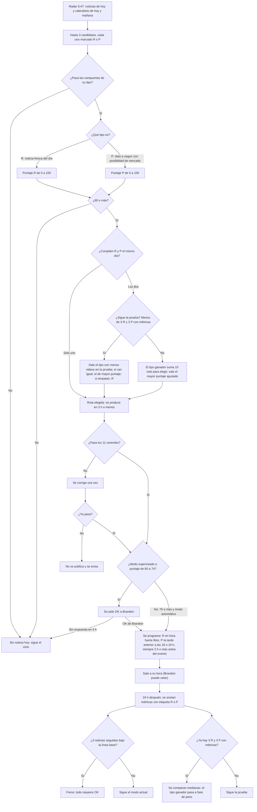

# Protocolo de NOTICIAS — video opcional del día (creado 2026-11-09; tipos R y P: 2026-11-10; regla «atención + puente al dinero», segunda pasada 13:00 y modo automático: 2026-11-14)

Objetivo: sacar un video de noticia (financiera o de algo que mucha gente está viviendo, con puente a su dinero) el mismo día del hecho (idealmente a menos de 12 h), sin depender de producto, y decidir solo si vale la pena publicarlo. Si ese día no hay noticia que lo merezca, no hay noticia: el ciclo normal sigue igual.

## 0. Dos tipos de noticia y la prueba entre ellos (decisión 2026-11-10)
Idea tomada de un video de referencia (un dato de MAÑANA como gancho de urgencia) más la regla de que toda noticia debe ser útil para el dinero de quien la ve.
- **R · REACCIÓN (noticia fresca del día):** el hecho ya pasó (menos de 24 h). Gancho: «Hoy [hecho]». Cierra con «qué vigilar» y la fecha y hora del siguiente evento (puente hacia una previa).
- **P · PREVIA (dato a seguir con posibilidad de mercado):** evento oficial con fecha y hora confirmadas en las próximas 24 h y capacidad de mover mercado, peso o tasas. Gancho con hora: «Mañana a las 7:30, un solo número mueve tu dinero». Estructura: qué dato sale → por qué importa (cadena causa-efecto) → qué espera el consenso (con fuente) → si sale arriba / si sale abajo (efecto en el mercado, NUNCA pronóstico) → cuándo y dónde verlo.
- **Utilidad obligatoria (R y P):** una frase «qué significa para tu dinero en México» (peso, tasas, crédito, ahorro, fondos). Sin esa frase el video no pasa el control de calidad.
- **ESTÁNDAR PRO (2026-11-13, manda sobre lo de abajo):** guion, voz, diseño, animación, subtítulos y mezcla de toda noticia siguen `kit/PRO.md` (sistema `kit/app/src/pro.tsx`, rótulo de serie «NOTICIA · DD MMM» o «PREVIA · DD MMM»). Lo que sigue del estilo de noticia se conserva DENTRO de ese sistema: imagen del tema dibujada en código detrás de cada bloque (`noticia-fondos.tsx`, tenue), 4–6 piezas por bloque con cifras y fuente, verde/rojo con sentido. Duración 35–50 s. Sin cierre hablado de «sígueme» (va escrito). La frase «qué significa para tu dinero en México» sigue siendo obligatoria.
- **Estilo visual de noticia (anterior; ver Estándar Pro arriba)** (distinto del glosario claro y del de producto): fondo oscuro con imagen del tema (dibujada en código; no se descarga stock) que cambia en cada bloque bajo una capa oscura; pastilla de etiqueta arriba en cada bloque («ESE NÚMERO ES…», «Y LLEGA EN EL PEOR MOMENTO»); título en dos pesos; de 3 a 5 piezas por bloque que entran con la voz (tarjetas, barra de «lo esperado», cadena con flechas); verde y rojo con sentido (sube / baja); sin logo ni productos de Actinver. Se toma la estructura del video de referencia, no su diseño exacto ni sus rótulos. Plantilla nueva por crear: `kit/app/src/noticia.tsx`; mientras no exista, derivar de `kit/app/src/terror-bolsa/`.
- **Prueba R vs P:** la elección del día está en §3c y la medición en §7.

## 1. Dónde cae en la cadencia
- Glosario diario: igual (2:00, Buffer).
- **NUEVO 7:00 CDMX — Radar de noticias.** Revisa portales, movimientos del mercado y Google Trends, y además el calendario económico de hoy y de mañana (Banxico, INEGI, BLS y Fed) para detectar previas; deja 3 candidatos, cada uno marcado R o P, y un veredicto (GO / NO-GO) en `noticias/AAAA-MM-DD.md`. Si es GO, el mismo radar produce y programa el video.
- **SEGUNDA PASADA 13:00 CDMX (decisión 2026-11-14):** mismo radar, para lo que pasó después de las 6:47 (la caída de Outlook fue a las 11:30; lo de Huang cambió de noche). Si ya hay una noticia APROBADA o publicada ese día, la de la tarde solo registra y sugiere (cupo de 1 noticia al día). Una R detectada a las 13:00 se publica a las 18:00 o 19:00. La pasada de las 13:00 también sirve para la previa de un dato de la mañana siguiente (publicarla a las 18:00 o 19:00).
- 11:00 video principal: primero lee `noticias/AAAA-MM-DD.md`.
  - Si hay noticia aprobada ese día → la noticia ES el video principal del día (siguen siendo 2 videos al día).
  - El tema desplazado (educativo o producto) se queda de primero en su lista; no se pierde. El ciclo educativo-educativo-producto sigue por fecha; el tema desplazado sale en el siguiente turno de su tipo.
  - Estados del día en `noticias/AAAA-MM-DD.md`: APROBADA (la noticia es el principal), ESPERA_OK (lista pero sin permiso: el principal sale normal y, con OK, la noticia sale como publicación extra si cabe en el cupo de 3) y NO_GO.
  - Si no hay noticia → ciclo normal.
- Herramienta de publicación: Metricool (video largo), mismo flujo de `publicar-temp`.

## 2. Compuertas (si falla UNA, no hay video)
1. **Fresca (R) o Agendada (P):**
   - R: el hecho tiene menos de 24 h y se puede publicar a menos de 8 h de detectarlo.
   - P: el evento sale en las próximas 24 h con fecha y hora confirmadas por fuente primaria (calendario de Banxico, INEGI, BLS o Fed), y el video puede salir 2 h o más antes del evento. Si no cabe esa ventana, la previa se descarta (nunca se publica después del evento).
2. **Verificada:** el dato central está en 2 fuentes independientes, una primaria o agencia (Reuters, Bloomberg, AP, Banxico, INEGI, BMV, Fed).
3. **Segura:** temas permitidos (decisión 2026-11-14): finanzas y mercado, y TAMBIÉN tecnología, caídas de servicios, empresas y personas famosas de negocios, finanzas o desarrollo personal, siempre con un puente honesto a su dinero o trabajo. Fuera: política partidista, tragedias, crimen y espectáculos sin puente. Un hecho sin confirmación oficial (por ejemplo una muerte reportada solo por medios) solo entra con el formato «lo que sí sabemos y lo que no», sin afirmarlo en el gancho, y nunca como algo confirmado. Además: sin «compra/vende», sin rendimientos, sin rumores ni personas privadas, sin postura partidista (solo el efecto en el mercado), sin tragedias como gancho, sin productos ni logo de Actinver. En P además: no se pronostica el resultado; «lo esperado» es el consenso citado con fuente y hora, los escenarios son «si sale arriba / si sale abajo», y las probabilidades de mercado (por ejemplo CME FedWatch) solo se citan con fuente y fecha.
4. **Cupo:** máximo 1 noticia al día y 3 a la semana; 3 publicaciones en total ese día; 3 h o más entre publicaciones; hora entre 7:00 y 21:00.
5. **Hilo claro:** se cuenta en 3 frases. R: qué pasó → a quién golpeó → qué vigilar. P: qué dato sale y cuándo → qué se espera → qué cambia si sale arriba o abajo.
6. **Factible:** guion de 60 s o menos y entrega en 3 h o menos.

## 3. Puntaje de REACCIÓN (R, 0–100) · regla «ATENCIÓN + PUENTE AL DINERO» (vigente desde 2026-11-14)
Por qué cambió: con la tabla anterior (centrada en cuánto se movió el mercado) el radar no detectó ninguna de las 3 noticias que mejor funcionaron (Outlook, renuncia de Huang, Brian Tracy); Outlook sacaba 34–47. Lo que funciona es lo que mucha gente está viviendo o comentando, con una lección real para su dinero. Antes: ver `HISTORIAL-DECISIONES.md`.
| Criterio | Puntos | Cómo se califica |
|---|---|---|
| Atención | 0–35 | Se toma el MAYOR: top 10 de Google Trends México o EE.UU. = 35; top 11–25 = 25; caída o falla de un servicio masivo (banco, app, Microsoft, Google, WhatsApp; Downdetector con decenas de miles de reportes) = 25; en portada de 3 o más medios GENERALES (no solo financieros: Milenio, El Universal, AP, Reuters, N+) = 25; mercado: índice (S&P 500, Nasdaq, IPC) 2 % o más, peso 1.2 % o más, empresa emblemática 8 % o más, o decisión o dato oficial que sorprende = 20; índice 1–2 %, peso 0.7–1.2 %, emblemática 5–8 % o dato oficial esperado = 10; solo 1 portal = 5; nada = 0. |
| Cercanía | 0–20 | La gente lo vivió (usa el servicio, lo paga, le cambia el precio) o conoce bien al protagonista = 20; lo conoce de nombre = 10; ajeno a su vida = 0. |
| Puente al dinero en México | 0–20 | Acción concreta y verdadera para su dinero o trabajo (proteger su cuenta, pedir un reembolso, revisar su crédito, qué pasa con el peso o las tasas) = 20; lección general útil (qué aprender de esto) = 10; sin puente honesto = 0 → **no pasa**, aunque sume 60. |
| Frescura | 0–15 | 6 h o menos = 15; hasta 12 h = 10; hasta 24 h = 5. Un seguimiento con un hecho nuevo (causa, reembolso, cifra final) cuenta desde ese hecho nuevo. |
| Claridad del ángulo | 0–10 | Qué pasó + por qué + qué hacer o vigilar, todo verificado = 10; falta uno = 5; faltan dos = 0. |
| Bono de gancho | +5 | El #1 de Google Trends es la noticia o se conecta de forma real con ella. No se fuerza. |

Prueba con casos reales (2026-11-14): Outlook 12 nov ≈ 25+20+20+15+10 = **90**; Microsoft créditos ≈ 25+20+20+5+10 = **80**; Huang renuncia ≈ 25+10+10+15+10 = **70**; Brian Tracy ≈ 25+20+10+10+5 = **70**; Wall Street 13 nov (−0.4 %) ≈ 5+0+10+5+5 = **25** (sigue fuera). Con la regla nueva las 4 noticias que sí funcionaron pasan y el día plano sigue fuera.

## 3b. Puntaje de PREVIA (P, 0–100)
Mismas escalas y mismos umbrales que R, para poder compararlas.
| Criterio | Puntos | Cómo se califica |
|---|---|---|
| Peso del evento | 0–30 | Tipo de evento (hasta 20): decisión de tasa (Banxico o Fed) o inflación (INEGI o EE.UU.) = 20; nómina de EE.UU., PIB, minutas = 14; otro dato oficial = 8. Posibilidad de mover mercado (hasta 10, con fuente): la última vez que salió movió S&P 500, IPC o USD/MXN 1 % o más = 10; 0.5–1 % = 5; menos = 0. |
| Interés de búsqueda | 0–25 | Top 10 de Google Trends = 25; top 11–25 = 18; portada de 3 o más medios (generales o financieros) = 10; 1 portal = 4; nada = 0. |
| Relevancia para México | 0–20 | Toca peso, tasas, crédito, ahorro, Afore o precios = 20; bolsa de EE.UU. con efecto en IPC o peso = 12; solo extranjera = 4. |
| Ventana | 0–15 | Sale 12–24 h antes del evento = 15; 6–12 h = 10; 2–6 h = 5; menos de 2 h = no hay previa. |
| Claridad del ángulo | 0–10 | Dato + lo que espera el consenso (con fuente y hora) + escenarios arriba/abajo, todo verificado = 10; falta uno = 5; faltan dos = 0. |
| Bono de gancho | +5 | Igual que R (§3). |

## 3c. Elección de ruta: noticia fresca (R) o dato a seguir (P)
1. Cada candidato se califica con la tabla de su tipo (R: §3, P: §3b).
2. Solo compiten los que pasan las compuertas y llegan a 60 o más.
3. Si compite un solo tipo, sale ese.
4. Si compiten R y P el mismo día:
   - **Fase de prueba** (mientras no haya 3 R y 3 P publicadas con métricas a 24 h): sale el tipo que lleve MENOS videos en la prueba, para igualar la muestra. Si van igual, el de mayor puntaje; si empatan en puntaje, R.
   - **Fase de peso** (después de la prueba): el tipo ganador (§7) recibe +10 puntos solo para elegir entre R y P (no cuentan para pasar los umbrales). Sale el de mayor puntaje ajustado.
5. La elección y su motivo se anotan en `noticias/AAAA-MM-DD.md`. Cupo sin cambios: 1 noticia al día y 3 a la semana, así que la prueba completa (6 videos) toma unas 2 semanas.

## 4. Decisión (igual para R y P)
- **75 o más → se aprueba sola.** Se produce, pasa el control de calidad y se programa.
- **60 a 74 → se produce y se pide OK a Brandon.** Si no contesta en 4 h, se descarta (no se publica).
- **50 a 59 → SUGERENCIA.** No se produce; se le manda a Brandon (tema, puntaje y desglose, ángulo propuesto). Si responde «hazlo», se produce y pasa por la ruta de 60–74.
- **Menos de 50 → se descarta.** Se anota en `noticias/` para tener historial.
- **Siempre se avisa:** cada pasada del radar manda a Brandon sus 3 mejores candidatos con puntaje, aunque el estado sea NO_GO, para que pueda corregir al radar si ve algo que se le pasó.

**Modo AUTOMÁTICO desde 2026-11-14** (decisión de Brandon; ya hay 3 noticias publicadas con su OK). 75 o más se programa solo, al menos 2 h adelante (ventana de veto). **Modo supervisado** solo después de un freno automático (§7): mientras dure, todo requiere OK de Brandon sin importar el puntaje.

## 5. Control de calidad antes de programar (los 11 deben pasar)
1. Duración de 45 a 60 s (máximo 75).
2. Primer fotograma con el tema; gancho de 8 palabras o menos con la fecha del hecho (P: con la hora del evento).
3. Cada cifra (voz y pantalla) coincide con su fuente; tabla cifra → fuente → hora dentro del guion. En P: el consenso con su fuente y hora, y escenarios arriba/abajo sin pronóstico.
4. «Contenido educativo, no es recomendación de inversión» en pantalla final y en la descripción.
5. Sin logo ni productos de Actinver, sin rendimientos prometidos, sin «compra» o «vende».
6. Transcripción (Whisper) de la voz final: nombres y cifras bien dichos; sin preguntas en la voz (o con la receta de `pregunta.py`).
7. Audio en −15 LUFS (±1), sin silencios de más de 0.5 s, voz por encima de la música.
8. Fotogramas revisados: nada cortado ni encimado.
9. Portada PNG, descripción y hashtags listos.
10. Hora libre en Metricool y Buffer (cupo respetado).
11. **Utilidad:** el guion trae la frase «qué significa para tu dinero en México» (peso, tasas, crédito, ahorro o fondos) y el video muestra de 3 a 5 piezas por bloque, que entran con la voz.

Si falla algo: se corrige una vez. Si falla otra vez: no se publica y se avisa a Brandon.

## 6. Programación y ventana de veto
- **R:** primera hora fuerte libre, al menos 2 h adelante (10, 12, 18, 19 CDMX), máximo 8 h después de detectar la noticia.
- **P:** la tarde anterior al evento, a las 18:00 o 19:00. Si el evento es después de las 14:00 del mismo día, sale esa mañana a las 10:00 o 12:00. Siempre 2 h o más antes del evento y 24 h o menos antes; si no cabe, no se publica.
- Se avisa a Brandon con MP4, portada, descripción y hora. Puede cancelarlo en Metricool antes de que salga.
- `isAigc` true; texto con la fecha del hecho y el aviso de no recomendación.

## 7. Seguimiento y freno automático
- A las 24 h se anotan tipo (R o P), vistas, tiempo promedio visto y retención en `noticias/registro.md`.
- **¿Funcionó como noticia? (2026-11-14):** a las 24 h, FUNCIONÓ si tiene vistas iguales o mayores a la mediana de los últimos 10 videos de la cuenta Y tiempo promedio visto de 7 s o más; si cumple solo una, PARCIAL; si no cumple ninguna, NO FUNCIONÓ. Se anota en el registro junto con su puntaje. En la revisión del 20 nov (y cada 2 semanas) se compara puntaje contra resultado: si varias noticias de 75 o más NO FUNCIONAN o varias de menos de 60 que Brandon pidió FUNCIONAN, se ajustan los pesos de §3.
- **Prueba R vs P:** cuando haya 3 R y 3 P con métricas a 24 h, se compara la MEDIANA de cada tipo, en este orden: (1) tiempo promedio visto; si difieren menos de 10 %, (2) vistas respecto a la mediana de los últimos 10 videos; si sigue empatado, (3) compartidos + guardados + comentarios por cada 1,000 vistas. Gana el tipo que gane el primer criterio no empatado. El resultado se anota en el registro y se pasa a la fase de peso (§3c). Es una muestra pequeña: orienta, no demuestra; se puede repetir con 3 más de cada tipo.
- **Freno:** si 3 noticias seguidas quedan en tiempo promedio visto igual o menor a la línea base (≈ 3 s, 2026-11-06) o con menos vistas que la mediana de los últimos 10 videos, el modo automático se pausa y todo pasa a «requiere OK».
- Si una fuente primaria corrige una cifra publicada: aviso inmediato y retiro del post si aún no ha salido.
- Revisión general de métricas: 2026-11-20.

## 8. Diagrama de flujo

## 9. Fuentes para el radar
**Obligatorio en cada pasada (2026-11-14):** (1) Google Trends México y EE.UU. con WebFetch a https://trends.google.com/trending?geo=MX y ?geo=US (o vía subagente web-fetch); si no se puede leer, anotarlo y buscar «tendencias hoy México»; (2) portadas de medios GENERALES (Milenio, El Universal, N+, Infobae México, AP, Reuters), no solo financieros; (3) Downdetector México (caídas de bancos, apps y servicios); (4) lo de abajo. Reuters, Bloomberg, AP, El Financiero, Expansión, El Economista; Banxico, INEGI, BMV, Fed; calendarios oficiales para previas (calendario de anuncios de Banxico, calendario de difusión del INEGI, calendario de publicaciones del BLS y calendario de la Fed; un calendario de terceros sirve solo como pista y la hora se confirma en el oficial); Google Trends (tendencias del momento, México y EE.UU.). Nota: Google Trends no tiene API oficial; hay que probar el acceso (búsqueda web o Chrome) y, si falla, usar las búsquedas en tendencia de Google y X.

Prueba 2026-11-09: WebFetch SÍ lee https://trends.google.com/trending?geo=MX (tabla de los 25 primeros temas con búsquedas, inicio y estado, últimas 24 h). El feed https://trends.google.com/trending/rss?geo=MX devolvió una copia vieja (27 oct 2026): NO usarlo. Trends ordena temas en alza, no "noticias más vistas": casi todo es deporte y espectáculos; para finanzas se cruza con portales y mercado, y solo cuenta el bono de gancho si hay conexión real.

## Estilo «pantalla saturada de información» (decisión de Brandon, 2026-11-12)
Cada noticia se investiga a fondo (no solo el dato central) y la pantalla se llena de información complementaria: de 4 a 6 piezas por bloque (cifras, línea de tiempo, comparaciones, citas cortas con fuente, mapa de afectados, qué hacer), más una franja inferior de datos extra. Siempre sobre el **fondo con imagen del tema** de cada bloque: librería `kit/app/src/noticia-fondos.tsx` (`<TopicBg kind="inbox|servers|phone|alert|search|chart" />`, imagen dibujada en código, tenue, bajo capa oscura; cambia con el bloque). Ejemplo de uso: `kit/app/src/outlook.tsx`. El video de Outlook del 12 nov (v1) salió sin estos fondos; el seguimiento del 13 nov ya debe usarlos. Densidad no significa más voz: el guion sigue en 45–60 s; lo extra va en pantalla y se verifica igual (cifra → fuente → hora).

